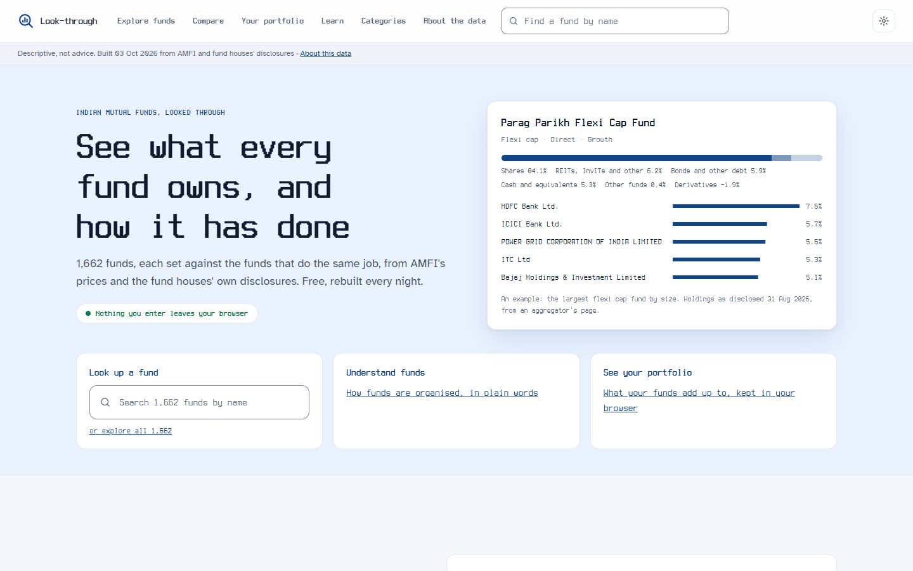
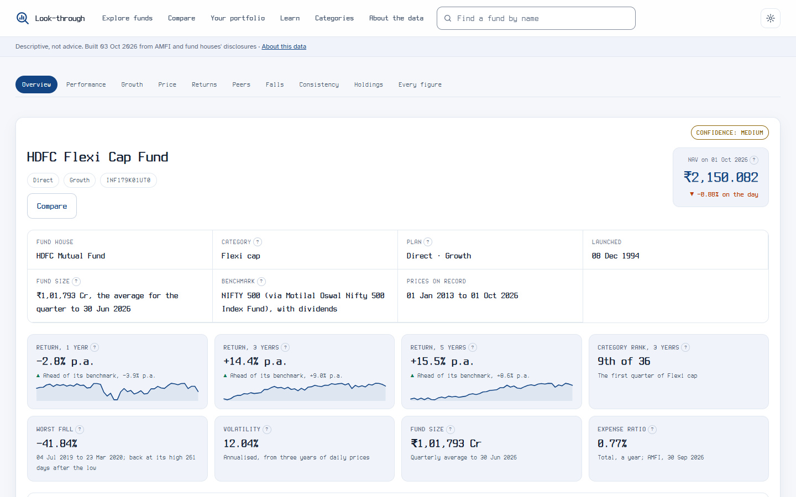
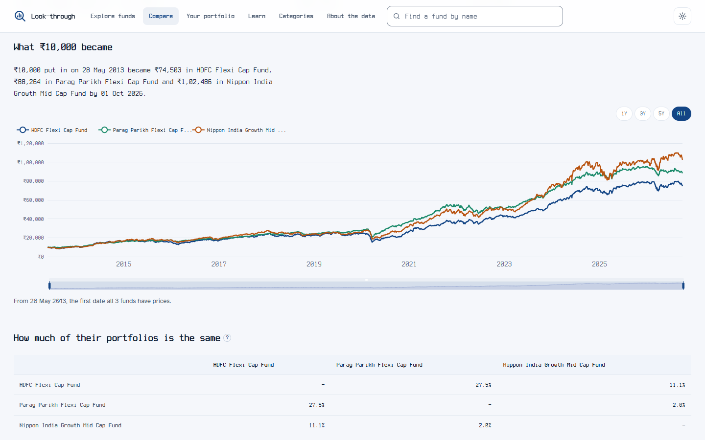
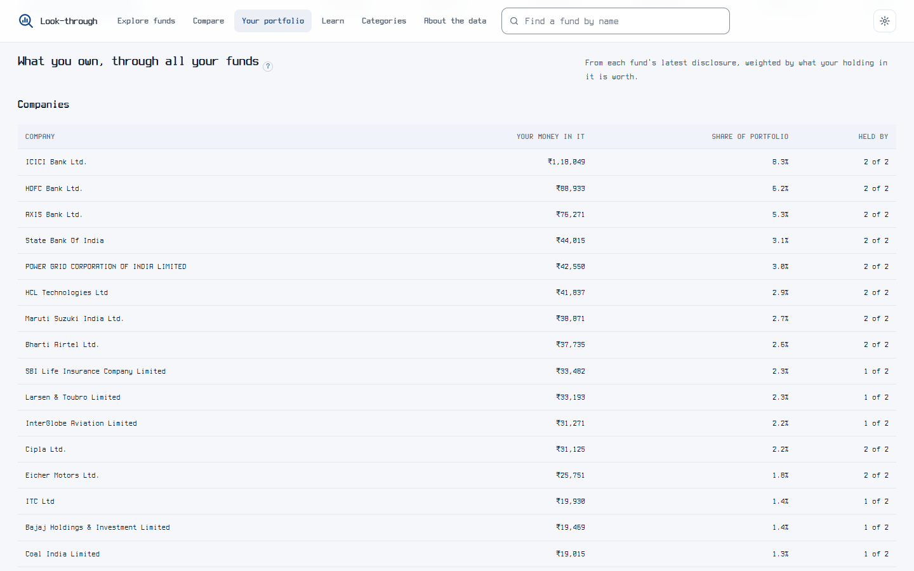

# Mutual Fund Portfolio Analyser

[](https://github.com/harshilsaini26/Mutual-Fund-Portfolio-Analyser.io/actions/workflows/ci.yml)
[](LICENSE)
[](https://www.python.org/downloads/)

**See what your mutual funds actually own.**

Tools for Indian mutual fund investors. They look through the funds you hold to the
companies underneath, show how much of your money is the same stock bought several
times over, and measure each fund against the index it is supposed to beat. There is a
free public website for anyone, and a private workbench that runs on your own machine
with your real transactions, encrypted, never leaving it.

```
HDFC Flexi Cap  x  Nippon India Growth Mid Cap
    overlap        13.32%          17 shared companies of 156
    duplicated     6.66% of the portfolio held through more than one fund
```

**Try it now:** <https://didmysipwork.vercel.app/>. It's rebuilt every night, and nothing
you enter leaves your browser.


| The front page | A fund page |
| --- | --- |
|  |  |
| **Compare** | **Your portfolio** |
|  |  |

---

## The tools at a glance

| Tool | Who it is for | Where it runs | What you need |
| --- | --- | --- | --- |
| **Public fund site** | anyone choosing or checking a fund | the web, [didmysipwork.vercel.app](https://didmysipwork.vercel.app/) | a browser |
| **Private workbench** | an investor analysing their own holdings | your computer, at `127.0.0.1:8765` | Python 3.11+, your CAS statement |
| **Data pipeline** | both of the above | your computer, or GitHub Actions | an internet connection and a contact email |
| **Nightly publisher** | whoever runs their own copy of the site | GitHub Actions → `gh-pages` → Vercel | a GitHub fork and a free Vercel account |

All four share one engine: the same Python computes every figure, whether it ends up on
the public site or in your private workbench.

## Contents

1. [The problem](#1-the-problem)
2. [Who it is for](#2-who-it-is-for)
3. [Goals and non-goals](#3-goals-and-non-goals)
4. [What each tool does](#4-what-each-tool-does)
5. [How it works](#5-how-it-works)
6. [How we know the numbers are right](#6-how-we-know-the-numbers-are-right)
7. [Privacy and security](#7-privacy-and-security)
8. [Getting started](#8-getting-started)
9. [Reference](#9-reference): commands, configuration, troubleshooting
10. [Status, open questions and what comes next](#10-status-open-questions-and-what-comes-next)
11. [For developers](#for-developers)

---

## 1. The problem

Five equity funds look like diversification. Opened up, they are often one portfolio
bought five times, with five sets of fees. No factsheet shows this, because a factsheet
describes one fund, and overlap is a property of the set.

The data needed to see it is **public but scattered**:

- SEBI makes every fund house publish its full portfolio each month, with an ISIN
  for each holding. But about 40 fund houses publish it in about 40 different
  spreadsheet and PDF formats, and change them without notice.
- Company names don't match from one file to the next ("HDFC Bank Ltd", "HDFC Bank
  Limited", "HDFCBANK"), so the files can't be joined until each name is matched to
  one company.
- Fund pages compare a fund with a price index that leaves out dividends, which
  flatters the fund by about 1.3% a year on the Nifty 50.

Doing this joining is a lot of work, so few tools do it, and investors are left judging
their portfolio by fund names.

## 2. Who it is for

**A curious investor (the public site).** Someone with a few funds who wants to know
whether they're any good, without installing anything or signing up.

- As a curious investor, I want to look up any fund by a few words of its name, so that I
  can see its returns, falls, costs and holdings on one page.
- As a curious investor, I want to see how a fund ranks among others of its kind, so that
  I know whether its return was skill or just the market it sits in.
- As a curious investor, I want to set two to four funds side by side, so that I can see
  how much of them is the same companies before I add one.
- As a curious investor, I want to know what a monthly SIP in a fund would have become,
  so that I can judge its record in rupees rather than percentages.
- As a curious investor, I want every term explained where it appears, so that I don't
  have to look up "Sortino" or "tracking error" elsewhere.

**A hands-on investor (the private workbench).** Someone who wants the full picture of
their own portfolio, built from their real transactions.

- As a hands-on investor, I want to import my CAS statement, so that my real units and
  purchase history are the starting point, not an estimate.
- As a hands-on investor, I want to see every company I own beneath my funds, so that I
  know my true exposure to, say, one bank.
- As a hands-on investor, I want to see what each fund adds that the others don't, so
  that I can drop the ones that only duplicate.
- As a hands-on investor, I want my transactions encrypted and kept on my own machine,
  so that no one else ever holds them.

**A maintainer (the pipeline and publisher).** Someone who runs their own copy.

- As a maintainer, I want the site to rebuild itself every night from public sources,
  so that it stays current without my involvement.
- As a maintainer, I want each command to tell me what is stale and how to fix it, so that
  I never have to guess.

## 3. Goals and non-goals

### Goals

1. **Show what a set of funds really owns**: holdings joined across funds onto one
   company list, with overlap and duplication measured.
2. **Judge each fund fairly**: against a benchmark that includes dividends, and against
   its own category, Direct plans only.
3. **Never show a number that looks right and isn't**: an unknown figure is shown as
   unknown, never as zero, and every figure shows its date and how much of the fund's
   holdings it could cover.
4. **Keep personal data personal**: no account and no telemetry. Transactions stay
   encrypted on the investor's own machine. The public site does its arithmetic in the
   browser.
5. **Run itself**: one command to start, and one nightly workflow to publish.

### Non-goals

| Not this | Why |
| --- | --- |
| Investment advice or recommendations | It describes what happened; it never says what to buy |
| A broker or trading terminal | It never touches money or places an order |
| A multi-user service with logins | It is built for one person on one machine; the public site has no accounts |
| Forecasts | Every figure looks back. The SIP page says so on its face |
| Getting past CAPTCHAs or bot checks | Where a site has one, the project uses a published interface or asks you to download the file |

## 4. What each tool does

Status key: **Built** works today · **Partly built** works with stated gaps ·
**Planned** specified, no code yet.

### 4.1 The public fund site: Built

Every open fund with a Direct plan and a year of prices, about 1,800, rebuilt every
night. It is a static site: no server and no database, and the figures that depend on
what you enter are worked out in your browser.

| Page | What it answers |
| --- | --- |
| **Front page** `/` | How are funds organised, and which have done best in each large equity category over three years? |
| **Explore funds** `/funds/` | Every published fund in one table, sortable by size, cost, return or category rank, and narrowed by family of fund, category or name |
| **Fund page** `/fund/<ISIN>/` | Everything about one fund (see below) |
| **Compare** `/compare/` | Two to four funds side by side: their figures, what ₹10,000 became in each, how much of their portfolios is the same companies, and what each holds |
| **Your portfolio** `/portfolio/` | Pick funds and amounts, and see their value, return and look-through, each fund set beside others of its category. It's kept in your browser, or saved to a file you keep |
| **What would a SIP have become?** `/sip/` | An amount, monthly or as a single lump sum, over 1, 3, 5 or 10 years or from a chosen month. What it became in real funds of a kind, at their real past prices, and how widely the outcomes spread |
| **Learn** `/learn/` | Every term the site uses, in plain words, with the sources each explanation was checked against. A `?` beside a term opens its explanation in place |

**A fund page** leads with a strip of figures. It shows returns over 1, 3 and 5 years
beside the benchmark's, its rank in its category, its worst fall and how long the
recovery took, its volatility, size and expense ratio. Below the strip come:

- **Performance:** return, volatility and deepest fall beside the benchmark's. Then
  Sharpe, Sortino, Treynor, alpha, beta, tracking error, information ratio, and up and
  down capture, each with a line on what it says.
- **What ₹10,000 became** against the benchmark with dividends reinvested, and the full
  **price history**.
- **Among its peers:** its rank on return, risk, worst fall, return for the risk, and
  cost. A chart of the whole category's risk against return marks where it sits.
- **Falls and recoveries**, and **consistency**: the return of every three-year stretch,
  not only the one ending today.
- **What it owns:** asset mix, its largest holdings, and bars by company size and by
  sector.

Every panel exports to CSV and carries its as-of date, how stale it is, and how much
could not be resolved. The gear in the top bar sets the theme (device, light, dark or
Matrix), font, text size, density, motion and accent, and your browser remembers them.

### 4.2 The private workbench: Built (fund analytics partly built)

A local web app built from your **Consolidated Account Statement (CAS)**. It opens at
<http://127.0.0.1:8765>, and only your own machine can reach it.

| Page | The question it answers |
| --- | --- |
| Portfolio summary | Where do I stand? |
| Look-through exposure | What do I actually own, beneath the funds? |
| Fund overlap | Am I paying twice for the same thing? |
| Duplication | How much of my money is doubled up? |
| What each fund adds | Which funds bring something the others don't? |
| Concentration | How concentrated am I really? |
| Size profile | How much is large, mid and small cap, on AMFI's list at the time? |
| Holdings | What do I hold? Each fund links to its fund page |

Underneath, the ledger tracks purchase lots first-in-first-out and computes XIRR and
time-weighted returns. It reconciles every statement against itself. The same fund pages
as the public site are here too, built from your local warehouse.

### 4.3 The data pipeline: Built

The pipeline fetches each source politely, archives every response under its SHA-256
hash, reads it, matches holdings to companies by ISIN, checks it, and loads it.

| Data | Source | How often |
| --- | --- | --- |
| Prices, and the list of funds | AMFI | daily |
| Price history | mfapi.in | once per fund, then kept |
| Fund sizes and expense ratios | AMFI | quarterly and monthly |
| Company size classes | AMFI | half-yearly |
| Portfolios | Kotak and ICICI through their interfaces; HDFC, Nippon and PPFAS from their workbooks | monthly |
| Portfolios for every other fund | Groww's public fund pages, a hundred a night | monthly once filled in |
| Benchmark levels (total return) | NSE, on your own machine only | daily |

### 4.4 The nightly publisher: Built

A GitHub Actions workflow builds the whole site on a fresh machine from public sources
alone. It pushes the site to the `gh-pages` branch, which Vercel serves. It keeps only
one Vercel deployment, deleting the older ones once the new one is live, so the free plan's
storage never fills up.

## 5. How it works

```
 public sources ─► fetch ─► archive ─► parse ─► resolve ─► validate ─► warehouse
 (AMFI, mfapi,      (rate-limited,     (per fund  (names to   (totals,      (SQLite)
  fund houses,       robots.txt)        house)     ISINs)      AMFI size)       │
  Groww, NSE)                                                                   │
                                     ┌──────────────────────────────────────────┤
 your CAS PDF ─► ledger (encrypted) ─┤                                          │
                                     ▼                                          ▼
                    look-through, overlap, fund x-ray         nightly build ─► static site
                                     │                                          │
                                     ▼                                          ▼
                    private workbench (127.0.0.1)            gh-pages ─► Vercel
```

- **Python computes every figure.** The view layer only displays them, and a static
  check enforces that.
- **The browser's arithmetic is pinned to the ledger's.** Your portfolio, Compare and
  the SIP page do their sums in JavaScript. Shared test cases hold that JavaScript to
  the Python ledger's answers.
- **The pages are complete without JavaScript** wherever they don't need your input.
  The only vendored script is ECharts, checked against a SHA-256 list. Neither CI nor
  the nightly build needs Node.
- **Modules depend in one direction:** data → ledger → fund analytics → look-through →
  views. They talk through typed interfaces, never each other's tables.

## 6. How we know the numbers are right

Most of the engineering is not the arithmetic. It is refusing to show a number that
looks right and is not.

| Principle | What it means in practice |
| --- | --- |
| **Exact arithmetic** | Money, units, prices and weights are `Decimal` end to end. SQLite's silent float conversions and text sorting are each guarded against, and each was found as a defect first |
| **Nothing disappears** | A holding that can't be matched shows as unresolved. A fund with no published portfolio shows as undisclosed |
| **Absent is not zero** | A return that can't be computed shows as a dash, never `0.00%`. A history too short for a statistic gets none |
| **Every file is checked** | Each disclosure is checked against the total the fund house printed in it, and against AMFI's own size figure. A 100× unit error fails both |
| **Benchmarks include dividends** | Price-only index series are never used |
| **It stops rather than guesses** | A redemption larger than the units held means a statement is missing, and the ledger stops rather than inventing the difference |

**How this is measured:**

- **Mutation testing:** defects are injected into the ledger and the look-through
  engine on purpose, and the tests must catch every one. Today they catch 26 of 26 and
  35 of 35.
- **Independent check:** a separate verifier recomputes the reference portfolio
  without importing any of the code it checks.
- **Every push** runs lint, strict types, the Python and JavaScript test suites, the
  verifier, and an audit of every pinned dependency for known vulnerabilities. GitHub's
  code scanning runs on top.
- **Every figure shows its coverage:** its date, how stale it is, and what share of
  holdings were matched, so you can judge how far to rely on it.

## 7. Privacy and security

- **Your data stays yours.** Transactions, units and folio numbers live in a
  SQLCipher-encrypted ledger. Without its key it refuses to open, rather than falling
  back to plain text. There is no account, no telemetry, and no server beyond the one
  you start.
- **The public site keeps nothing.** What you type into Your portfolio, Compare or the
  SIP page stays in your browser, in its storage or its address bar. The nightly build
  never opens a ledger.
- **Polite by construction.** Every request is rate-limited per site, respects
  `robots.txt`, and identifies who is fetching.
- **Untrusted input is treated as untrusted.** Names are escaped before they reach a
  page, and spreadsheet formulas are neutralised on export. Workbook XML is parsed
  safely, and archives can't write outside their folder. Every page carries a strict
  content security policy. The local server answers only to `127.0.0.1` and
  `localhost`, which blocks DNS rebinding. Each of these protections has a regression
  test.
- **One known limit:** the local server has no login. While it runs, any program on the
  same computer can read your portfolio through it. That's fine on a personal machine,
  but don't run it on a shared one.

---

## 8. Getting started

### 8.1 Use the public site

Open <https://didmysipwork.vercel.app/>. There is nothing to install.

### 8.2 Run the private workbench

**You need** Python 3.11 or later, git, and about 1.5 GB of disk. On Linux or macOS the
encrypted ledger also needs SQLCipher: `sudo apt install libsqlcipher-dev` or
`brew install sqlcipher`.

```bash
git clone --single-branch https://github.com/harshilsaini26/Mutual-Fund-Portfolio-Analyser.io.git
cd Mutual-Fund-Portfolio-Analyser.io
python start.py
```

On macOS and some Linux systems the command is `python3`. The `--single-branch` flag
skips `gh-pages`, which holds only the published site.

That one command:

1. **Makes a private Python environment** in `.venv` and installs the pinned
   dependencies. It does this again only when the dependency list changes.
2. **Asks once for your email.** It goes in the `From:` header of every request, so
   sources can reach whoever is fetching. It is kept in `data/`, which is never
   committed.
3. **Loads the market data.** The first run takes a few minutes, plus about 70 minutes
   for NSE's index history:

   | Step | What it loads |
   |---|---|
   | `prices` | today's price for every fund, and AMFI's list of funds |
   | `companies` | AMFI's list of listed companies by size |
   | `fund_sizes` | each fund's size, from AMFI's quarterly averages |
   | `kotak`, `icici` | those fund houses' latest portfolio disclosures |
   | `portfolios` | loads the disclosures just downloaded |
   | `benchmarks` | which index each fund is measured against |
   | `history` | price history for the funds with a portfolio |
   | `index_levels` | benchmark levels from NSE (the slow one) |

4. **Opens the workbench** in your browser. Until you import a statement, its home page
   is a short setup checklist and a search box.

If a step fails, the others still run, and the next start tries it again. The same goes
if you stop part-way. `python -m jobs.setup --list` shows which steps are done. Every
later start is the same command: it refreshes today's prices in seconds and opens the
workbench. Stop it with `Ctrl+C`.

Every other command runs inside the private environment, so activate it once per
terminal:

```bash
source .venv/bin/activate          # macOS / Linux
.venv\Scripts\activate             # Windows (Command Prompt or PowerShell)
source .venv/Scripts/activate      # Windows (Git Bash)
```

### 8.3 Add your own portfolio

1. **Get the statement.** Ask CAMS, KFintech or MF Central for a *detailed* CAS (with
   transactions) covering the time since your first investment. Any one of them covers
   every fund house. It arrives as a PDF protected by a password you choose.
2. **Import it.** Stop the workbench, activate the environment, and run:

   ```bash
   python -m jobs.import_cas --file path/to/statement.pdf --user USER-01
   ```

   It asks for **the statement's password**, which is used once and never stored. Then
   it asks for a **ledger key** (the prompt reads `Zone B ledger key`), which locks
   `data/ledger/personal.db`. On the first import you choose the key: at least 12
   characters, typed twice. **There is no recovery:** without the key, no one can open
   the file, this project included.

   It ends with one summary line:

   | Field | What it means |
   |---|---|
   | `inserted` | new transactions saved |
   | `duplicate` | transactions already in the ledger (re-importing is safe) |
   | `unmatched` | transactions it did not recognise; set aside, not saved |
   | `unparsed_lines` | lines inside a fund's section it could not read |
   | `status` | `ok`, or `partial` when either of the two above is not zero |

3. **Look.** Run `python start.py` and enter the ledger key. The home page becomes your
   dashboard, and the sidebar lists the eight portfolio pages in [4.2](#42-the-private-workbench-built-fund-analytics-partly-built).

A newer statement imports the same way, and it's fine for its period to overlap an
earlier one: transactions already in the ledger are skipped. To see the output without a
statement, `python -m scripts.show_lookthrough --equal 1000000` weights every loaded fund
equally. It labels itself illustrative and saves nothing.

### 8.4 Load more funds' holdings

Prices cover every fund from the start. **Holdings**, which the look-through and "what
it owns" depend on, are loaded per fund house, in order of preference:

| Fund house | How |
| --- | --- |
| **Kotak, ICICI** (have an interface) | `python -m jobs.fetch_amc --amc kotak --period 2026-08`, then `python -m jobs.ingest_inbox`. Add `--list` to see what is published |
| **HDFC, Nippon, PPFAS** (have a reader) | Download the monthly portfolio workbook into `data/inbox/`, then `python -m jobs.ingest_inbox`. It identifies the house and each fund's sheet, and skips with a reason rather than guessing |
| **Any other fund** (aggregator tier) | `python -m jobs.fetch_groww --slug <slug> --dry-run`, then without `--dry-run`. Slugs are in `https://groww.in/mf-sitemap.xml`. Groww's pages have no ISINs, so fewer holdings match, and a fund house's own file is always preferred |

[`config/amc_disclosure_index.yaml`](config/amc_disclosure_index.yaml) links the
disclosure page of all 52 fund houses. After loading a new house, run
`python -m jobs.fetch_index --declared` to pick up the benchmarks it names.

### 8.5 Keep it current

| When | What to run |
|---|---|
| Any day | `python start.py`, which refreshes prices before opening |
| Monthly, after the 10th | new disclosures ([8.4](#84-load-more-funds-holdings)); SEBI allows fund houses ten days after month end |
| After each new statement | `python -m jobs.import_cas ...` |
| To see what is out of date | `python -m jobs.status`, which names the command that fixes each item. Add `--check` to also ask Kotak and ICICI what they have published |

### 8.6 Publish your own copy of the public site

The workflow `.github/workflows/site.yml` runs every night, or when you start it by
hand. Between runs it keeps only the site itself. The site includes a compact copy of
every fund's prices and of the portfolios read from Groww, so a normal night fetches
little. The first run takes about an hour. Groww's portfolios fill in over about
sixteen nights at a hundred pages a night, then refresh monthly.

To turn it on, once:

1. **GitHub → Settings → Secrets and variables → Actions → Variables:** add
   `MF_CONTACT_EMAIL`, the address sent with every request. The build stops without
   it.
2. **[Vercel](https://vercel.com)** (the free Hobby plan is enough): import the
   repository with the preset **Other**. Leave the build and install commands empty and
   set the output directory to `.`. The first deployment, of `main`, shows a 404. That's
   expected, because `main`'s `vercel.json` switches its own deployments off.
3. **Actions → site → Run workflow** to publish the first time.
4. **Vercel → Settings → Environments → Production:** track `gh-pages`, promote that
   deployment, and turn off Vercel Authentication so visitors aren't asked to log in.
5. **Optional, to keep one deployment:** add the secret `VERCEL_TOKEN` and the variable
   `VERCEL_PROJECT` (and `VERCEL_TEAM_ID` if the project is on a team). Each night then
   deletes the older deployments once the new one is live. Run the workflow once by hand
   with `prune_only` to clear the backlog.

The public copy leaves out NSE's index levels, which are licensed for personal use only.
Where an index fund tracks the same benchmark, its price stands in for the index, and the
page names it. Portfolios read from Groww are marked as such, and Groww's terms apply to
them.

To build it on your own machine and preview it:

```bash
python -m jobs.build_site --out site --base ""          # about an hour the first time
python -m http.server -d site 8000                      # then open http://127.0.0.1:8000
```

---

## 9. Reference

### Commands

| Command | What it does |
|---|---|
| `python start.py [--no-browser] [--port N]` | set up what is missing, refresh prices, open the workbench |
| `python -m jobs.setup --list` / `--only <step>` | the setup steps and which are done / run one again |
| `python -m jobs.serve` | the workbench alone, with no setup or refresh |
| `python -m jobs.import_cas --file <pdf> --user USER-01` | import a CAS statement |
| `python -m jobs.fetch_amc --amc kotak\|icici` | fetch a fund house's disclosure |
| `python -m jobs.ingest_inbox` | load every workbook in `data/inbox/` |
| `python -m jobs.fetch_groww --slug <slug>` / `--crawl 100` | holdings from Groww, one fund / up to 100 from its sitemap |
| `python -m jobs.backfill_scheme_nav --scheme <ISIN>` | one fund's full price history |
| `python -m jobs.backfill_scheme_nav --universe --missing` | history for every open fund still short of it |
| `python -m jobs.fetch_ter [--month YYYY-MM]` | AMFI's expense ratios for a finished month |
| `python -m jobs.status [--check]` | what is stale, and the command that fixes it |
| `python -m scripts.show_fund_xray --scheme <ISIN>` | one fund's statistics in the terminal |
| `python -m scripts.show_lookthrough` | your look-through in the terminal |
| `python -m jobs.publish_site [--push]` | build (and publish) the public copy from this machine's warehouse |
| `python -m jobs.build_site --out site [--store site] [--push]` | the nightly build: the public copy from the public sources alone |

### Configuration

Nothing needs setting. These override the defaults:

| Variable | Default | What it does |
|---|---|---|
| `MF_CONTACT_EMAIL` | the email saved at first run | `From:` header on every outbound request |
| `MF_DATA_ROOT` | `./data` | where the warehouse, ledger and raw archive live |
| `MF_WAREHOUSE` | `$MF_DATA_ROOT/warehouse/canonical.db` | a specific market-data database |
| `MF_LEDGER` | `$MF_DATA_ROOT/ledger/personal.db` | a specific encrypted ledger |
| `MF_CAS_PASSWORD` | unset | the optional real-statement test only; everything else prompts |

### Troubleshooting

| Symptom | What to do |
| --- | --- |
| The first run takes a long time | `index_levels` fetches NSE's history within its rate limit, about 70 minutes. Stopping is safe; the next start resumes |
| A setup step failed | The next `python start.py` retries it, or run `python -m jobs.setup --only <step>` to see the full error |
| Port 8765 is in use | `python start.py --port 8766` |
| "password rejected by the PDF" | That's the statement's password (chosen when you requested the CAS), not your ledger key |
| Forgot the ledger key | It can't be recovered. Move `data/ledger/personal.db` aside and import your statements again under a new key |
| `sqlcipher3` fails to install | Install the SQLCipher library first ([8.2](#82-run-the-private-workbench)), then rerun `python start.py` |
| A panel says it has no data | Its message names what's missing, usually price history (`jobs.backfill_scheme_nav --scheme <ISIN>`) or holdings ([8.4](#84-load-more-funds-holdings)) |

---

## 10. Status, open questions and what comes next

**Where it stands.** It's a working system at an early stage, published as it is. It has
not yet been used with real money, its author's included. That's why every figure shows
its date, staleness and coverage, so you can judge for yourself how far to rely on it.
It describes what happened and is not investment advice.

| Area | Status |
| --- | --- |
| Data pipeline | Built |
| Ledger: CAS parsing, lots, XIRR and time-weighted returns, reconciliation | Built |
| Look-through: exposure, overlap, duplication, concentration, nested funds, what each fund adds | Built |
| Views: public site and private workbench | Built |
| Fund x-ray: returns, risk, benchmark statistics, peers | Partly built; the manager history and turnover need data no public source gives cleanly |
| Portfolio risk | Planned |
| Market context: news and events filtered by what you hold | Planned |
| Tax calculation | Planned; rates will come from a human-verified file, never invented |

**Known gaps:**

- **Most fund houses have no disclosure of their own loaded** (47 of 52). The public site
  fills the gap from Groww's pages, where fewer holdings can be matched.
- **Peer ranks leave out closed funds.** Nothing public records a fund that was wound up
  or merged, so every peer panel says it compares survivors only.
- **The local workbench's peer panels need every fund's history loaded** first
  (`backfill_scheme_nav --universe --missing`). The public site already has them.

**Open questions:**

| Question | Who it depends on |
| --- | --- |
| Is there a clean public source for a fund manager's tenure, so returns can be credited to whoever earned them? | data |
| Can closed and merged funds be recorded, so peer ranks stop counting only the survivors? | data |
| Can the public site carry total-return benchmarks without NSE's licensed levels? | licensing |
| Does the workbench need a per-launch token, for anyone running it on a shared computer? | security |

**What comes next:** portfolio risk, then market context, then tax, each built end to
end before the next one starts.

---

## For developers

```bash
pip install -e ".[dev,cas]" -c requirements.lock   # inside .venv; start.py installs [cas] only
python -m pytest -q                                # hermetic, no network
node --test "tests/js/*.test.mjs"                  # the browser's arithmetic, against the ledger's
python -m ruff check .
python -m mypy                                     # strict
python -m scripts.verify_v0_ledger --check         # the independent ledger verifier
```

[CI](.github/workflows/ci.yml) runs exactly these on every push, plus `pip-audit`.
`requirements.lock` pins the whole dependency graph, and pip uses it as a constraints
file. The local server is the standard library's WSGI server, and fetching uses
`urllib`. There's no web framework and no HTTP client dependency.

```
start.py              one-command setup and start
jobs/                 command-line entry points: fetch, load, import, serve, publish
src/m0_data/          fetch, parse, resolve, validate, load     the market warehouse
src/m1_ledger/        statement parsing, lots, returns          your positions
src/m2_fund/          returns, risk, benchmark analytics        fund x-ray
src/m3_lookthrough/   exposure, overlap, concentration          look-through
src/m6_views/         pages, charts, export, local API          what you see
migrations/           numbered, forward-only schema changes
docs/media/           the README's tour and screenshots
```

[`docs/CLAUDE.md`](docs/CLAUDE.md) sets out the ten invariants the rest of the code
follows. [`docs/PROGRESS.md`](docs/PROGRESS.md) records current coverage, how each figure
was measured, and the known defects.

## Built with Claude

The specification, implementation, tests and documentation were written with
[Claude Code](https://claude.com/claude-code). The commit history records that work as
it happened, including the defects the tests caught in freshly written code and the
estimates that turned out wrong.

## Licence

[MIT](LICENSE).
